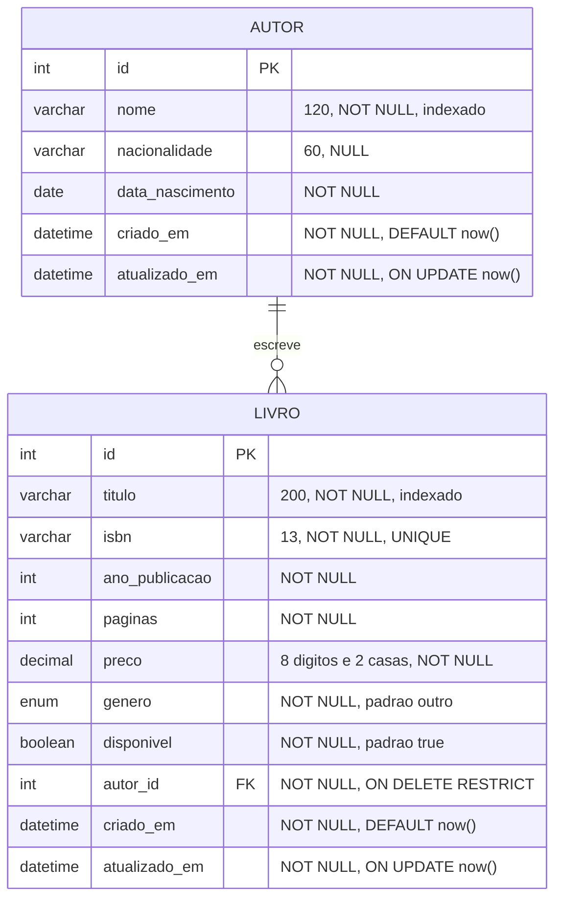

# API Biblioteca — Projeto SQL (Megadados)

Microsserviço **RESTful** para gerenciar o acervo de uma biblioteca: **autores** e seus **livros**.
Feito com **FastAPI**, ORM **SQLModel** (sobre SQLAlchemy) e banco **MySQL**.

📹 **Vídeo de demonstração:** [_adicione aqui o link do vídeo_](https://youtu.be/6sJq4Cib0IA)

## Funcionalidades

- **CRUD completo de Autores** — criar, listar (paginação + filtro por nome/nacionalidade), obter, substituir (PUT), alterar parcialmente (PATCH) e remover.
- **CRUD completo de Livros** — mesmas operações, com filtros por título, autor, gênero e disponibilidade.
- **Relacionamento 1:N** — cada livro pertence a um autor (chave estrangeira). `GET /livros/{id}` já devolve o autor embutido e `GET /autores/{id}/livros` lista os livros de um autor.
- **Integridade garantida pelo banco** e traduzida em respostas HTTP:
  - ISBN repetido → `409 Conflict`;
  - livro apontando para autor inexistente → `422 Unprocessable Content`;
  - remover autor que ainda tem livros → `409 Conflict` (`ON DELETE RESTRICT`).
- **Validação de entrada** (Pydantic): tamanhos de texto, ISBN-13 com 13 dígitos, preço ≥ 0 com 2 casas decimais, ano de publicação e data de nascimento que não podem estar no futuro, gênero restrito a uma lista, `null` proibido em campos obrigatórios no PATCH.
- **Documentação automática** em `/docs` (Swagger UI) e `/redoc`, com título e descrição de cada rota, descrição e exemplo de cada campo/parâmetro e as respostas de erro possíveis.

## Modelo relacional



Tipos usados: inteiro, texto, data, data e hora, decimal, booleano e enumeração.
Valores de `genero`: `ficcao`, `ficcao_cientifica`, `fantasia`, `romance`, `misterio`, `poesia`, `biografia`, `historia`, `tecnico`, `infantil`, `outro`.

## Rotas

| Método | Rota | Descrição | Sucesso |
|---|---|---|---|
| GET | `/` | Índice com links para a documentação e coleções | 200 |
| POST | `/autores` | Cria autor (header `Location` aponta para o novo recurso) | 201 |
| GET | `/autores` | Lista autores (`offset`, `limit`, `nome`, `nacionalidade`) | 200 |
| GET | `/autores/{autor_id}` | Obtém um autor | 200 |
| GET | `/autores/{autor_id}/livros` | Lista os livros do autor | 200 |
| PUT | `/autores/{autor_id}` | Substitui todos os dados do autor | 200 |
| PATCH | `/autores/{autor_id}` | Altera só os campos enviados | 200 |
| DELETE | `/autores/{autor_id}` | Remove autor sem livros | 204 |
| POST | `/livros` | Cria livro | 201 |
| GET | `/livros` | Lista livros (`offset`, `limit`, `titulo`, `autor_id`, `genero`, `disponivel`) | 200 |
| GET | `/livros/{livro_id}` | Obtém um livro com os dados do autor | 200 |
| PUT | `/livros/{livro_id}` | Substitui todos os dados do livro | 200 |
| PATCH | `/livros/{livro_id}` | Altera só os campos enviados | 200 |
| DELETE | `/livros/{livro_id}` | Remove livro | 204 |

Erros retornam `{"detail": "..."}` com `404` (não encontrado), `409` (conflito) ou `422` (dados inválidos).
Toda resposta traz `Cache-Control`: leituras bem-sucedidas são `no-cache` (podem ser guardadas, mas devem ser revalidadas, pois o banco pode mudar), as demais `no-store`.

## Como executar

Pré-requisitos: Python 3.12+ e um MySQL 8 (o `docker-compose.yml` sobe um pronto).

```bash
# 1. Dependências
python -m venv .venv
source .venv/bin/activate          # Windows: .venv\Scripts\activate
pip install -r requirements.txt

# 2. Credenciais: copie o exemplo e troque as senhas
cp .env.example .env

# 3. Banco (opcional, se não tiver MySQL instalado): usa as credenciais do .env
#    --wait só retorna quando o MySQL está pronto para conexões (~20 s na 1ª vez)
docker compose up -d --wait

# 4. API (as tabelas são criadas automaticamente na inicialização)
fastapi dev app/main.py
```

Acesse a documentação interativa em <http://127.0.0.1:8000/docs>.

> Usando um MySQL já instalado? Crie o banco e o usuário definidos no `.env`:
> ```sql
> CREATE DATABASE biblioteca CHARACTER SET utf8mb4;
> CREATE USER 'biblioteca'@'%' IDENTIFIED BY 'sua-senha';
> GRANT ALL PRIVILEGES ON biblioteca.* TO 'biblioteca'@'%';
> ```

### Exemplo rápido

```bash
curl -X POST http://127.0.0.1:8000/autores -H 'Content-Type: application/json' \
  -d '{"nome": "Machado de Assis", "nacionalidade": "Brasileira", "data_nascimento": "1839-06-21"}'

curl -X POST http://127.0.0.1:8000/livros -H 'Content-Type: application/json' \
  -d '{"titulo": "Dom Casmurro", "isbn": "9788535910667", "ano_publicacao": 1899,
       "paginas": 256, "preco": "39.90", "genero": "romance", "autor_id": 1}'

curl -X PATCH http://127.0.0.1:8000/livros/1 -H 'Content-Type: application/json' -d '{"disponivel": false}'
```

## Credenciais

Nenhum segredo é versionado: a configuração vem de variáveis de ambiente / arquivo `.env` (ignorado pelo git),
lida com `pydantic-settings`. A senha é tratada como `SecretStr` e a URL de conexão é montada com
`sqlalchemy.URL.create`, que escapa caracteres especiais. O modelo de configuração está em `.env.example`.

## Estrutura do projeto

```
app/
├── main.py            # App FastAPI: metadados da documentação, middleware Cache-Control, rotas
├── core/
│   ├── config.py      # Configurações lidas do .env
│   └── database.py    # Engine MySQL, criação das tabelas e sessão por requisição
├── models/
│   ├── autor.py       # Tabela Autor + schemas Create/Update/Public
│   ├── livro.py       # Tabela Livro, enum Genero + schemas
│   └── comum.py       # Validação compartilhada
└── routers/
    ├── autores.py     # Rotas /autores
    ├── livros.py      # Rotas /livros
    └── comum.py       # Paginação, 404, tradução de erros de integridade do MySQL
```

Cada entidade tem schemas separados para entrada (`Create` para POST/PUT, `Update` para PATCH) e saída
(`Public`), de modo que campos gerados pelo banco (`id`, `criado_em`, `atualizado_em`) não podem ser
enviados pelo cliente.

## Uso de IA

Ferramenta utilizada: **Claude** (Anthropic), através do agente de linha de comando **omp**.

Como foi usada:
- leitura do enunciado e escolha do tema/modelagem (autores e livros, tipos de dados, restrições);
- geração do código da API (modelos SQLModel, rotas FastAPI, tratamento de erros, configuração);
- testes manuais de todas as rotas contra um MySQL real (container Docker), incluindo casos de erro;
- redação deste README.
